# AI Route & Stay Planner

An interactive travel-planning application built with **Python** and
**Streamlit** to help users plan trips across India. It supports both
single-city and multi-city journeys, attraction selection, stay
recommendations, route ordering, day-wise itineraries, budget estimates,
and PDF itinerary export.

> **Project status:** The current application includes the features
> documented below. A Gemini-powered AI Travel Copilot is a possible
> future enhancement and is not part of the current implementation.

## Application Screenshots

### Home page

Choose between single-city and multi-city trip planning.

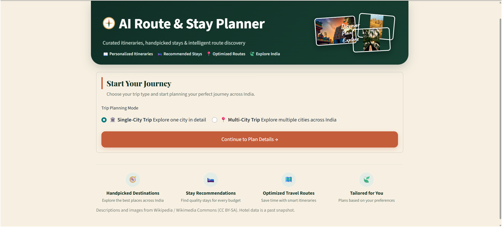

### Multi-city planning

Configure multiple destinations, travel dates, number of travellers, and
an optional budget.

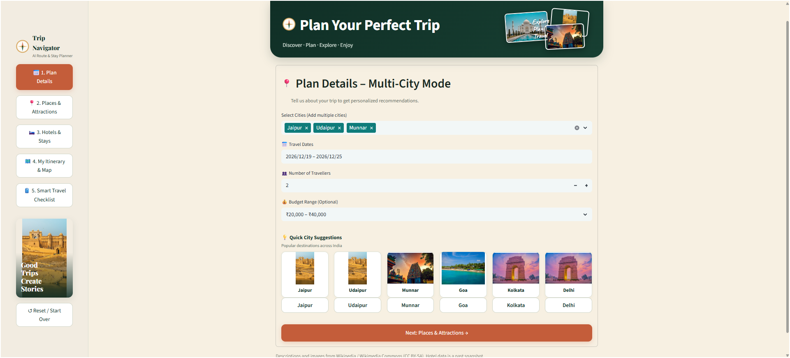

Browse and select attractions for each city.

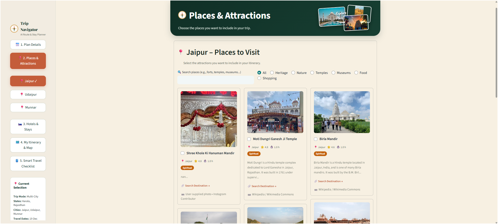

Explore hotel and stay recommendations.

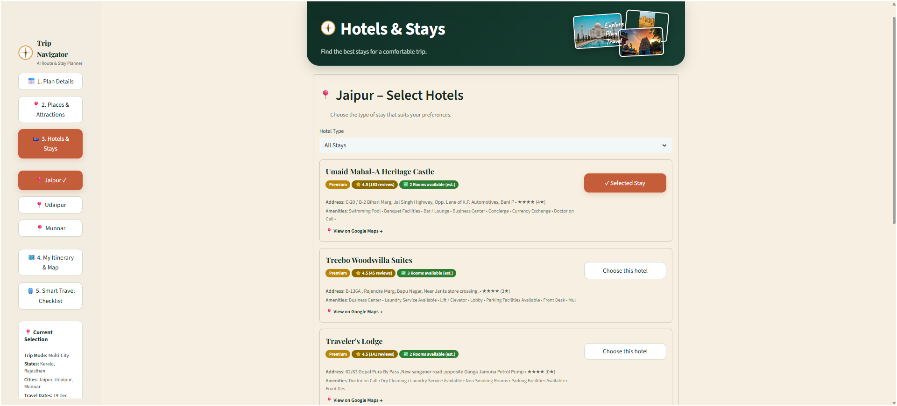

Use the dedicated packing checklist to track travel essentials and add
custom items.

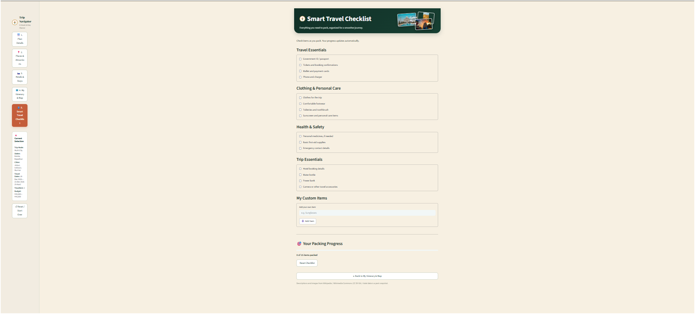

Review the city-wise itinerary, optimized multi-city route map, and
estimated budget.

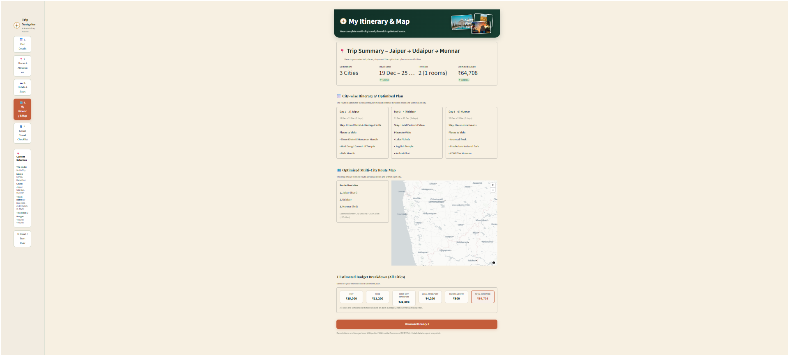

### Single-city planning

Configure a trip for one destination.

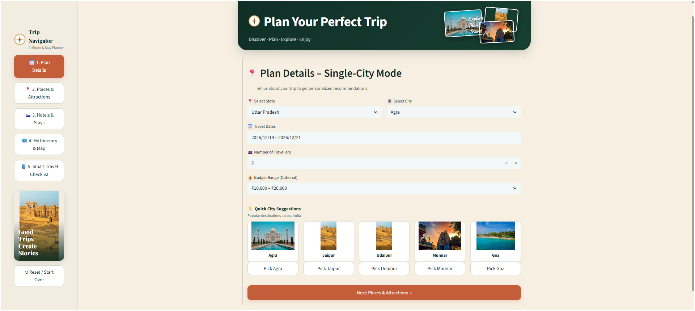

Search, filter, and select attractions.

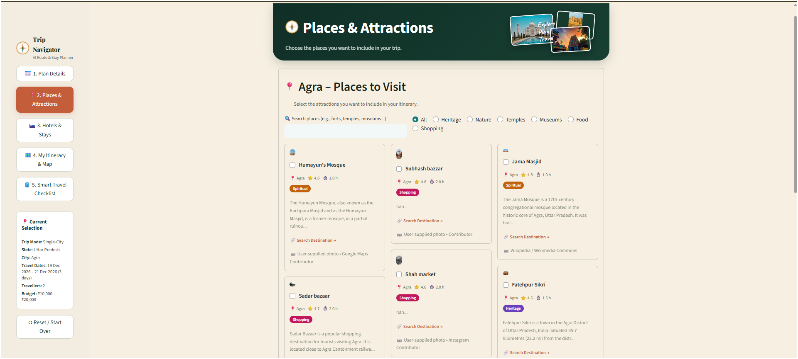

Compare recommended stays and select accommodation.

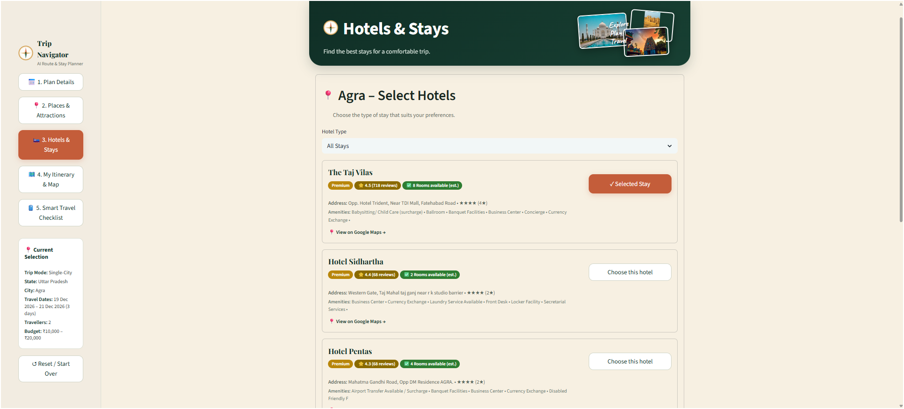

Review the day-wise schedule, route map, and budget estimate.

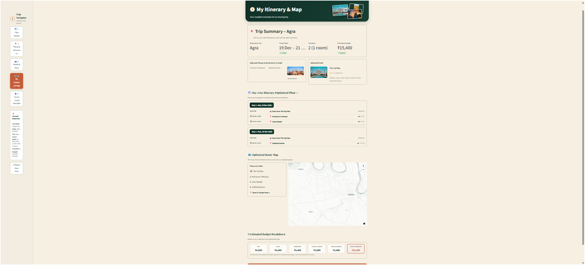

### PDF itinerary export

The application can generate a downloadable PDF containing trip details,
selected stays and attractions, the day-wise schedule, and estimated
budget.

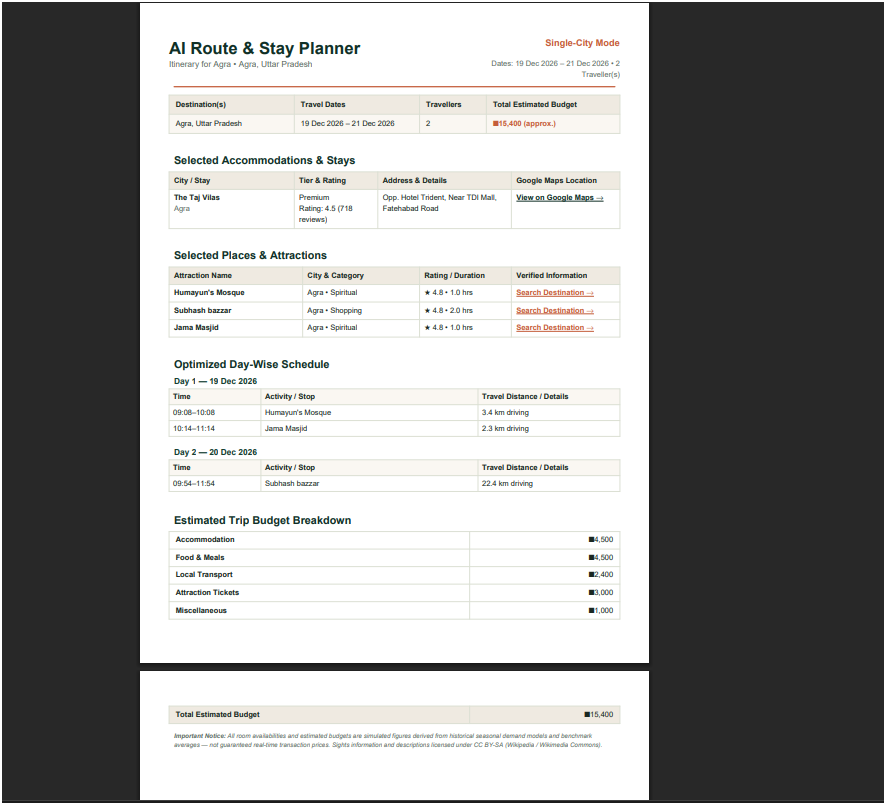

## Features

-   **Two trip-planning modes:** Plan a detailed trip within one city or
    create a journey across multiple cities.
-   **Trip configuration:** Select destinations, travel dates, traveller
    count, and an optional budget range.
-   **Attraction discovery:** Browse, search, filter, and select places
    to visit.
-   **Stay recommendations:** View accommodation details, ratings,
    amenities, and estimated room availability from the available
    dataset.
-   **Itinerary generation:** Organize selected attractions into a
    day-wise schedule.
-   **Route ordering:** Arrange attractions to reduce unnecessary travel
    and estimate route distances.
-   **Multi-city planning:** Plan journeys across multiple cities, with
    city-order optimization for supported trip sizes.
-   **Interactive maps:** View planned destinations and attraction
    routes.
-   **Budget estimation:** See an estimated trip budget and
    category-wise breakdown.
-   **Smart Travel Checklist:** Track packing essentials, add custom
    items, and monitor packing progress.
-   **PDF export:** Download a structured itinerary for the planned
    trip.

## Machine Learning and Algorithms

The project combines data-driven recommendations with geographic
calculations and route-planning algorithms.

  -----------------------------------------------------------------------
  Technique                           Role in the application
  ----------------------------------- -----------------------------------
  K-Means clustering                  Used in the stay-recommendation
                                      workflow.

  DBSCAN clustering                   Groups geographically close
                                      attractions into areas.

  Haversine distance                  Estimates geographical distance
                                      between coordinates.

  Nearest-neighbour ordering          Helps order selected attractions
                                      within a city.

  Permutation-based optimization      Evaluates city visit orders for
                                      supported multi-city trips of up to
                                      five cities.
  -----------------------------------------------------------------------

The application uses algorithmic estimates and the available datasets;
it is not a live navigation or booking service.

## Tech Stack

-   **Language:** Python
-   **Application UI:** Streamlit
-   **Data processing:** Pandas, NumPy
-   **Machine learning:** Scikit-learn
-   **PDF generation:** ReportLab
-   **Maps:** Interactive map components used by the Streamlit
    application

## Project Structure

The main application files include:

``` text
AI_Route_and_Stay_Planner/
│
├── app.py
├── planner_lib.py
├── multi_city_planner.py
├── travel_checklist.py
├── pdf_generator.py
├── requirements.txt
├── screenshots/
│   ├── 01-home-multicity.png
│   ├── ...
│   └── 11-pdf-export.png
└── README.md
```

Runtime datasets and image assets are not included in this repository.
They are excluded until their redistribution rights are confirmed.

## Getting Started

### 1. Clone the repository

``` bash
git clone https://github.com/rama1407/AI_Route_and_stay_planner.git
cd AI_Route_and_stay_planner
```

### 2. Create and activate a virtual environment

**Windows:**

``` bash
python -m venv venv
venv\Scripts\activate
```

### 3. Install dependencies

``` bash
pip install -r requirements.txt
```

### 4. Check the required data files

The application expects its required CSV datasets in the project
directory. They are intentionally not included in this repository, so
the app will not run until you provide permitted copies of at least:

-   `cities.csv`
-   `attractions_geo.csv`
-   `hotels_final.csv`

Some supplementary files are optional, but the core datasets must be
present for the corresponding application features to work.

**Dataset note:** Hotel information is a dataset snapshot, not a live
inventory or real-time price feed. If `hotels_final.csv` is not included
in the public repository, obtain a permitted copy and place it in the
project directory before running the application. Do not publish
datasets unless you have the right to redistribute them.

### 5. Run the application

``` bash
streamlit run app.py
```

Streamlit will display a local URL in the terminal. Open that URL in
your browser.

## Important Notes and Limitations

-   Road distances and travel durations are estimates based on
    geographical calculations and configured assumptions; they are not
    guaranteed road-navigation distances or live travel times.
-   The application does not provide live traffic, toll, road-closure,
    or transit information.
-   Hotel details, ratings, prices, and availability are based on the
    available dataset and may not reflect current real-world conditions.
-   Estimated budgets are planning estimates, not guaranteed quotes.
-   Recommendation quality depends on the completeness and quality of
    the underlying datasets.
-   Images and descriptions may be sourced from Wikipedia / Wikimedia
    Commons under the applicable licenses, as indicated in the
    application. Hotel data is a past snapshot.

## Future Enhancements

-   Gemini-powered AI Travel Copilot on a separate application page.
-   More personalized itinerary suggestions and natural-language trip
    assistance.
-   Additional live data integrations, subject to available APIs and
    data permissions.

These are planned enhancements, not features currently included in the
application.

## Author

**Ramalakshmi**\
B.Tech, Computer Science and Engineering\
IIIT Kottayam

------------------------------------------------------------------------

If you find this project useful, feel free to explore the repository and
share feedback.
